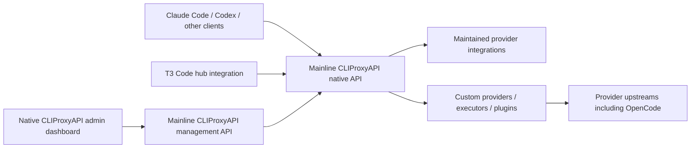

# Gateway product scope refactor: implementation plan

Status: proposed implementation sequence, authorized for planning; production migration requires a concrete staging result and approval.
Date: 2026-11-01.

## Product decision

Reposition the gateway as a small policy, discovery and compatibility product built on maintained provider infrastructure. Mainline [router-for-me/CLIProxyAPI](https://github.com/router-for-me/CLIProxyAPI) is the backend foundation, with the native upstream [CLI Proxy API Management Center](https://github.com/router-for-me/Cli-Proxy-API-Management-Center) served at `/management.html`. The CLIProxyAPIPlus backend fork is not selected. Pin the mainline backend release and its compatible native dashboard artifact. Alternative dashboards and a custom management UI are out of scope. Implement customizations at the provider/executor/plugin level wherever possible. A runtime helper is an exception only after demonstrating that these extension points cannot reasonably implement the requirement; a desire to reuse an existing sidecar is not sufficient justification. The current Tokligence backend becomes a migration backend rather than the mandatory foundation.

Success means fewer independently maintained authentication flows, serializers, retry loops and session stores, while preserving the client workflows and specialist APIs users need. Merely replacing one large custom implementation with a fork of another does not satisfy the goal.

The plan does not assume that CLIProxyAPI supports every provider, that opencode2api solves OAuth-backed Zen access, or that matching request bodies explains the observed429. Those are explicit evaluation gates.

## Target architecture and ownership

Keep CLIProxyAPI's native API available as a first-class integration surface, including the management/discovery operations required by T3 Code hubs. A custom façade must not become mandatory for T3 Code or ordinary clients. Network ingress/TLS and administrative access controls may protect these APIs without changing their contracts. Management access remains authenticated and scoped; availability does not mean anonymous public exposure.

| Concern | Single owner / rule |
| --- | --- |
| Public authentication, admin authorization, tenant identity | CLIProxyAPI native controls and protected ingress; provider runtimes remain private |
| Model catalog, aliases, free/paid eligibility, route configuration | One authoritative native configuration store; all accepted writes validated and revisioned |
| Protocol conversion | CLIProxyAPI for its routes; the selected adapter for other routes; no chained conversion |
| Upstream credentials and refresh | Provider backend/native runtime, never the public edge; one refresh owner per credential |
| Session affinity | Selected backend, using a principal-scoped stable conversation identity resolved at the CLIProxyAPI boundary |
| Retry and failover | One explicit route policy enforced at the dispatch owner; no hidden nested loops |
| Compatibility patches | Small named transforms at a documented boundary with evidence and regression fixtures |
| Quota state | Dispatch owner persists provider rejection/reset; native management/API surfaces sanitized state without extending it |
| Streaming and cancellation | End-to-end propagation; client disconnect cancels active upstream work |

Use CLIProxyAPI's configuration and extension mechanisms for policy, authentication and transformations before adding a custom process. Retain a separate compatibility proxy only for a specific unsupported contract that cannot reasonably be implemented in an extension, with an explicit retirement condition. Do not maintain a competing dashboard or management API. A runtime helper is not part of the default architecture. Before proposing one, document the exact missing extension capability, evaluated provider/plugin implementation, native dependency constraints, maintenance trade-off and state owner. If justified, it remains private behind the provider integration.

## Configuration and management contract

Version pairing is a release gate. The native dashboard's current documentation requires backend8.x and `/v8/management`, with no v0 fallback; the current gateway embeds7.3.20. Pin a compatible backend/dashboard pair, then verify the actual T3 Code API version and required operations. A successful v8 configuration write may migrate stored configuration: rehearse that migration before using a real installation. Do not attach a latest dashboard to the old backend or auto-update either artifact independently. See the [upstream dashboard documentation](https://github.com/router-for-me/Cli-Proxy-API-Management-Center).

Dashboard provider tests, playgrounds, quota actions and plugin actions must be classified by actual network behavior. Disable inference-triggering actions until they traverse the same bounded dispatcher as normal traffic. The upstream dashboard documents a browser-originated provider test: verify the pinned version does not expose credentials or bypass server dispatch controls through direct browser-to-provider requests. Such a path must be disabled or minimally patched before enabling the relevant UI action; it cannot be counted as a guarded request. Management login, status, discovery and ordinary configuration must remain usable without inference.

The selected backend's native configuration is the operational source of truth. Deployment provisions an initial configuration only for an empty installation; restart/redeployment must not overwrite accepted UI or T3 Code edits with a generated snapshot. Git holds defaults, schema, extension code and sanitized deployment manifests, never credentials or an independently authoritative live route policy.

Use native locking/write semantics first. Hashes can identify a revision but do not themselves prevent lost updates; demonstrate concurrent writer behavior before promising conditional writes. If safe multi-writer updates are unsupported, serialize administrative writes through existing native controls or constrain writers operationally, and document the limitation. Do not invent a configuration-control subsystem merely to achieve optimistic concurrency.

All supported management writers must use the backend's validated write path. Record a configuration revision/hash and reject conflicting writes, or serialize them where conditional writes are unavailable. Route activation must validate model eligibility, credential ownership, retry ceilings and extension compatibility before becoming effective. Define whether each setting is hot-applied or requires restart, and make the effective revision observable. A write that cannot be applied atomically must leave the prior valid revision active.

Safety invariants (no paid fallback, no inference probes, bounded dispatch, credential ownership and required administrative access controls) are enforced within the backend/provider boundary and cannot be bypassed through another management endpoint or reload. Do not assume a configuration interceptor exists: Phase1 must prove a supported enforcement point. If the selected backend cannot enforce these rules for every writer, record the gap and evaluate a minimal maintained extension or upstream change before admitting it. If neither is viable, block only the affected provider/operation and continue the verified platform slice; do not expand this into an unbounded core rewrite. A second configuration API/proxy is not the default solution.

Inventory the actual T3 Code hub contract from its implementation or documented integration: HTTP paths/methods, request/response fields, API version, authentication, streaming, timeouts and write behavior. Include connection/setup, model/provider discovery, configuration edits, credential operations where used, status/errors and reconnect. Mark unused operations explicitly rather than inventing requirements. Turn this inventory into executable contract fixtures and a staging integration checklist.

Separate inference and management keys. Determine whether T3 Code genuinely needs a broad management key; use narrower native permissions where supported, otherwise document the actual privilege and limit access to trusted clients/network paths. Verify the browser panel's authorization, origin/CSRF protections where applicable and that inference keys cannot call administrative operations. No credentials in contract recordings.

## Scope and non-goals

Preserve the public contract deliberately: Chat Completions, Responses, Anthropic Messages, model discovery, administrative authorization and operational diagnostics. Inventory count_tokens, System One, audio, speech, embeddings, OCR, moderation, FIM and realtime WebSockets separately; neither conversion support nor provider support may be inferred from chat support.

Keep exact-model requests exact. Explicit aliases may have a documented selection policy, but no automatic model, credential, paid-tier or network-path substitution after rejection. Unknown or unsupported semantic fields fail clearly instead of disappearing during conversion.

Do not rebuild a provider SDK, general agent framework, upstream account manager or universal schema optimizer. Do not add a community plugin solely because it advertises a provider. Do not treat Modal compute credits and a hosted free GLM endpoint as the same service.

## Phase0 — Baseline, requirements and freeze boundaries

1. Inventory effective routes, public endpoints, client configurations, credentials by owner label, quotas, specialist capabilities and operational dependencies. Use the current deployment and original checkout read-only; preserve unrelated ongoing work.
2. Create a capability matrix for every route: inbound/outbound protocol, authentication, tools, reasoning, images/documents, long context, stream/cancel behavior, token usage, cache fields and specialist endpoints. Label each supported, unsupported, unknown or untested with evidence.
3. Record current architecture and ownership costs: custom modules, patches, refresh owners, background HTTP/inference, failure recovery and deployment processes.
4. Preserve immutable live reports, cooldowns and successful reference metadata. The confirmed working OpenCode inference server is2.0.32; the2.2.5 executable upgrade did not replace that server. The current OAuth429 cause remains unresolved.
5. Establish a new refactor branch and separate staging configuration after preserving the existing OpenCode work. No production credential reuse, automatic import or source reset.

Deliverables: requirements matrix, route inventory, current contract fixtures and deployment/credential ownership map. Exit gate: each existing endpoint has an explicit migration or retention decision; no silent feature loss.

## Phase1 — Evaluate and pin the foundation

Pin and inspect an exact router-for-me/CLIProxyAPI commit/release and its native upstream admin dashboard artifact before executing either with credentials. Use the upstream Cli-Proxy-API-Management-Center dashboard; verify compatibility and required workflows. Evaluate release maintenance, provider support, extension APIs and licenses. Do not substitute a Plus backend fork to obtain a panel or provider. Alternative dashboard selection is out of scope. The repository currently embeds v7.3.20 for Codex; this is a starting fact, not an instruction to retain or upgrade it blindly.

Verify against source and isolated tests:

- Provider authentication precedence, refresh/storage behavior and extension API stability.
- Actual request/stream conversions, error propagation, cancellation and usage accounting.
- Retry, bootstrap retry, redirect, credential rotation and fallback behavior, including defaults and background jobs. Trace extension ordering relative to credential selection, protocol conversion, history repair, retries and physical network send. Prove the selected extension can enforce the dispatch budget and cooldown on every path, including management tests and scheduled jobs.
- Tenant/session isolation, credential affinity, concurrency and model discovery behavior.
- Security boundaries, management listener protection, dependency provenance, licensing and upgrade maintenance.

Provider discovery backlog:

| Provider/lane | Evaluation decision |
| --- | --- |
| Existing Codex and other supported providers | Prefer maintained native integration after contract tests; do not assume current configuration transfers unchanged |
| Mistral | Verify standard inference and each specialist API; generic compatibility may cover chat while a direct specialist adapter remains necessary |
| Cline OAuth | Identify the actual upstream service, supported authentication flow and plugin ownership; no presumed integration or credential sharing |
| Modal hosted free GLM | Identify exact service/endpoint, entitlement, credential lifecycle and limits; keep separate from Modal compute budget |
| OpenCode Zen free | Separate native-OAuth adapter investigation below; retain unresolved status |
| Other current routes | Retain existing backend until a verified replacement exists |

Deliverables: architecture decision record pinning backend/panel artifacts, extension lifecycle and write-path map, T3 Code contract inventory, and ownership boundaries. Exit gate: the first migration route, all management writers and every dispatch path satisfy the invariants through verified extension points. If that requires a core change, assess a small upstreamable patch explicitly rather than silently accepting a permanent fork. No platform slice begins while these boundaries remain unknown.

## Phase2 — Build the minimum platform slice

Implement only a single ordinary supported provider first:

1. Start the pinned mainline CLIProxyAPI backend and the native admin dashboard in staging with explicit configuration and no unused providers/plugins. Expose native APIs through protected ingress without a mandatory custom inference façade.
2. Implement identity, exact model selection, stable conversation scope and correlation IDs within the supported CLIProxyAPI boundary. Never trust a client-supplied internal principal header. Verify T3 Code can connect directly as a CLIProxyAPI hub.
3. Bootstrap the authoritative native configuration store once, implement validated/revisioned writes and verify persistence across UI edits, T3 Code writes, reload and redeployment. Expose a sanitized effective revision and component versions; reject stale/conflicting writes without losing accepted changes.
4. Disable unsafe defaults explicitly: automatic credential/tier fallback, quota retries, background inference checks and unbounded bootstrap attempts. Verify behavior by physical outbound request counts, not configuration inspection alone.
5. Preserve existing public/admin authorization and rate/budget boundaries. Separate management credentials from inference credentials; protect management endpoints with their native authentication and network access policy.
6. Add diagnostics for provider status/error type, reset, request ID, route/backend version, physical dispatch count and local versus upstream rejection. Redact credentials, prompts and raw reasoning by default.

Choose extension placement here: a supported provider/executor/plugin is the default. Implement native OAuth and compatibility behavior in the provider/plugin where feasible. Native-runtime reuse does not automatically authorize a helper: first demonstrate why an in-process provider/plugin cannot reasonably meet the requirement. Any helper or separate proxy then needs a documented exception. Avoid maintaining a CLIProxyAPI fork merely to add one provider.

Exit gate: synthetic tests exercise the full client-to-provider path, native panel management workflows, the inventoried direct T3 Code hub operations, conflicting configuration writes, reload/redeployment, process restart and rollback with no production changes. Prove forbidden dispatch remains blocked after UI/API edits and restart. Verify required native API paths, authentication, discovery, configuration and streaming remain compatible; do not infer hub compatibility from a successful chat request.

## Phase3 — OpenCode adapter selection and implementation

Evaluate opencode2api as a bounded component, not a preselected replacement. The inspected commit794546b supports API keys/anonymous access, reconstructs native headers, retries/falls back, performs inference availability probes and can insert placeholder reasoning. It does not establish native OAuth lifecycle support.

Before implementing a prototype, draw its exact request and state ownership path: inbound API, protocol converter, native compiler, physical transport, credential store, conversation store and reasoning store. Reject candidates requiring competing authoritative histories, placeholder reasoning or duplicate schema conversion. CLIProxyAPI owns inbound conversion only when its executor contract preserves everything needed by native generation; otherwise choose a supported raw/native boundary rather than another translation chain. Native compilation is the final upstream serialization, not a second general API translation.

First evaluate an in-process CLIProxyAPI provider/executor/plugin, using audited opencode2api and upstream OpenCode logic as references. Prototype only the uncertain seams needed to choose an implementation. Native runtime reuse and an opencode2api service front end are exception candidates, evaluated only if provider/plugin implementation has a demonstrated limitation; neither is a required default prototype. Score custom code, patches, request fidelity, upstream upgrade burden, resource usage, failure semantics and test coverage. Select one implementation and retire unused candidates; do not maintain parallel production implementations.

Required implementation work regardless of choice:

1. **OAuth:** native resolution/storage/refresh with one sequential owner. Do not copy a live token database into a second runtime. Stage any ownership handoff with stop/lock verification, rollback instructions and explicit credential labels. Keep the working Ubuntu profile untouched.
2. **Quota:** stop dispatch on401/403/429 or an uncertain terminal outcome. Preserve structured upstream errors and durable reset state across restarts. A local refusal never advances the provider reset. No anonymous fallback, credential rotation or retry after rejection.
3. **Background work:** remove inference availability probes. Catalog refresh must be non-inference, bounded and observable. Inventory native discovery/refresh separately; distinguish these requests from inference counts.
4. **Reasoning:** preserve actual returned reasoning and its tool-turn association through all supported protocols. Never fabricate reasoning to satisfy validation. Missing required history produces a specific error; any cache must be principal/session scoped, bounded and crash-safe. Missing live reasoning is untested coverage.
5. **Request generation:** prefer a provider/plugin implementation using upstream OpenCode request/authentication logic or maintained libraries where feasible. Compare the maintenance cost and fidelity of a narrow port/library integration against a private native-runtime helper only when an extension limitation is established. Neither a Go port nor a helper is presumed superior before evidence; track copied logic against pinned upstream versions with differential tests. Do not manually spoof a different version or inject fake tools.
6. **Sessions:** define create/reference/resume/model-switch/expiry/delete semantics. Serialize allocation/eviction, protect active requests, delete corresponding native sessions, prevent cross-principal collisions and never replay stored agent work automatically after restart.
7. **Tools:** caller owns execution unless the route explicitly selects a native agent product. Preserve IDs, parallel calls, results, failures and ordering. Withhold executable calls on length/filter/failure outcomes; never execute client tools inside the provider service implicitly.

Exit gate: pinned native reference and adapter pass differential API/body tests plus lifecycle/fault tests. Native runtime differences and intentional external-agent semantics are documented rather than normalized out of evidence.

## Phase4 — Compatibility patches and cache preservation

Implement patches within CLIProxyAPI providers/plugins where possible. Create a small patch registry: affected provider/protocol/version, concrete incompatibility, transform location, fixture, owner and retirement condition. Patches are opt-in per route and visible in diagnostics. No catch-all rewriting pipeline.

For each transform verify system/message ordering, tool schema serialization, reasoning/signatures, cache-control fields, prompt cache keys, usage attribution and truncation/compaction behavior. Preserve unknown fields only where the upstream contract allows them; reject unsupported semantics explicitly.

Do not promise cache preservation based on equivalent JSON. Establish a stable-prefix baseline and use actual provider cache-read/write usage where available. Unsupported cache evidence stays unknown. No server-side compaction or prompt optimization by default; those require a separate product decision and acceptance cases.

Exit gate: each retained patch fixes a demonstrated issue and does not cause a second schema translation or hidden prompt mutation.

## Phase5 — Independent acceptance layers

### Layer1: offline contracts and faults

Run protocol fixtures, provider-reference differential tests, credential isolation, session lifecycle, stream terminal/error framing, concurrency, crash recovery, timeout/cancellation and quota persistence tests. Assert physical dispatch counts for redirects, retries and nested fallbacks. Test image/document/redacted reasoning rejection where unsupported. Verify configuration and management isolation. Pin dependency/source hashes and keep sanitized evidence.

### Layer2: actual clients with synthetic upstreams

Run real Claude Code and other required clients through the complete staging architecture. Cover long input/output, parallel tools, denied/failed tools, reasoning-bearing continuation, partial streams, cancellation and process restart. Use scoped fixture tools and explicit noninteractive permissions. Synthetic success never counts as live provider acceptance.

### Layer3: bounded live acceptance

Prepare a reviewed per-case plan only after layers1/2 pass: exact model/auth owner/runtime, hypothesis, eligible time with a meaningful reset margin, request/output ceilings, pacing, stable run ID and stop conditions. Enforce a single-owner lease and durable no-replay ledger at the physical dispatch boundary. Existing active cooldowns and consumed IDs remain binding.

Begin with one matched successful reference/integration pair, then independently budget tools, reasoning, long response and actual Claude cases across the four allowed OpenCode models. Do not repeat passed basics each scheduler tick. No full matrix after a rejection. On401/403/429, malformed stream, timeout or uncertain outcome, stop further inference and retain evidence. No account/IP/model rotation to compensate. Expiry alone does not authorize another run.

Acceptance reports separate pass, fail, blocked and untested for each model/capability. Token counts alone are not reasoning replay proof. No numerical confidence or universal parity claim.

## Phase6 — Incremental migration and rollback

1. Deploy immutable staging snapshots with component/source/config hashes and health/readiness checks. Health/readiness must not invoke models.
2. Migrate one supported provider/client route at a time using explicit routing selection. No live shadow/dual dispatch: it doubles cost, quota use and refresh ownership risk.
3. Prepare a concrete production promotion packet: route diff, evidence, credential handoff, limits, operational changes and rollback procedure. Obtain production approval after that packet exists.
4. Observe the promoted route before moving the next. Watch error classification, physical dispatch amplification, cancellation latency, memory and refresh ownership; monitoring is not inference probing.
5. Before promotion, inventory configuration schema, credentials, session/history, reasoning and cooldown storage versions. Classify each change as backward compatible, reversible or irreversible. Rehearse rollback against representative synthetic persistent state, including interrupted writes and a simulated token rotation; verify the old runtime can read the resulting state or use an explicit compatible downgrade path. Never restore stale refresh tokens from a backup: credential rollback preserves the latest valid credential state and sequential ownership. Irreversible store changes block routine rollback and need a separate migration decision. Roll back routing/configuration to the previous immutable release. Credential ownership must transfer sequentially; rollback never starts a second refresh owner or restores a retired token file blindly. Provider cooldowns survive rollback.
6. Retain specialist adapters and legacy routes until their replacements pass their own gates. Remove obsolete modules, credentials, listeners and background jobs only after their routes are retired and rollback retention is agreed.

Exit gate: required workflows work through the new architecture; the old generic gateway is no longer on migrated request paths; retained custom modules have named responsibilities and tests.

## Maintenance budget and completion evidence

Start with one mainline CLIProxyAPI backend, the native admin dashboard and zero custom general-purpose proxy services or runtime helpers by default. Provider/executor/plugin customization comes first; helpers require the documented exception process. Each custom provider/plugin/helper/patch must declare its purpose, code/state ownership, upstream dependency, tests, upgrade procedure and retirement condition. Keep this inventory beside the route capability matrix.

Phase0 records a measured baseline: custom runtime services, authoritative stores, authentication implementations, protocol converters, core patches and custom modules. Every architecture decision includes the before/after count and maintenance cost. No second owner for the same concern is accepted to make a test pass. A proposal exceeding the starting service budget must demonstrate the extension limitation and explain why it reduces total maintenance. A permanent core fork requires an explicit product decision.

Completion requires a report showing which old services/modules/stores were removed, which remain for specialist routes, how many patches remain and who owns upgrades. Retaining the old general gateway indefinitely alongside mainline CLIProxyAPI does not count as completing the shift. Record external provider blockers separately from platform migration completion and from provider live acceptance.

## Execution order and stopping rules

Implement Phase0 inventory and Phase1 evaluation first, then the single-provider platform slice. Run the OpenCode prototype comparison after the extension boundary is known. Migrate low-risk supported routes before unresolved OAuth integrations; keep specialist routes explicit. Do not delay all useful migration work on the OpenCode429 investigation.

Each phase ends with a reviewable artifact and evidence, not an open-ended adversarial-review loop. Escalate only material product choices (dropping an endpoint, accepting a core fork, paid access, changing client semantics) or a concrete production promotion. Routine staging implementation and reversible fixes can proceed autonomously when authorized.

The refactor is complete when the required capability matrix is accepted, credential/retry/session ownership is singular, live coverage is truthful, rollback is demonstrated and custom maintenance scope is measurably reduced. An external provider rejection remains a documented blocker for that route, not a reason to claim completion or repeatedly probe it.
