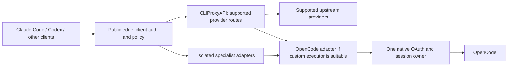

# Gateway product scope refactor: implementation plan

Status: proposed implementation sequence, authorized for planning; production migration requires a concrete staging result and approval.
Date: 2026-11-01.

## Product decision

Reposition the gateway as a small policy, discovery and compatibility product built on maintained provider infrastructure. CLIProxyAPI becomes the preferred inference foundation where its support is verified. Provider-specific native runtimes or isolated adapters cover remaining gaps. The current Tokligence backend becomes a migration backend rather than the mandatory foundation.

Success means fewer independently maintained authentication flows, serializers, retry loops and session stores, while preserving the client workflows and specialist APIs users need. Merely replacing one large custom implementation with a fork of another does not satisfy the goal.

The plan does not assume that CLIProxyAPI supports every provider, that opencode2api solves OAuth-backed Zen access, or that matching request bodies explains the observed429. Those are explicit evaluation gates.

## Target architecture and ownership

The two possible connections to the OpenCode adapter are alternatives. A route selects exactly one; it must not traverse both. Phase2 chooses the supported extension boundary.

| Concern | Single owner / rule |
| --- | --- |
| Public authentication, admin authorization, tenant identity | Slim public edge; private backend listeners remain inaccessible to clients |
| Model catalog, aliases, free/paid eligibility, route configuration | One versioned policy compiled into backend configuration |
| Protocol conversion | CLIProxyAPI for its routes; the selected adapter for other routes; no chained conversion |
| Upstream credentials and refresh | Provider backend/native runtime, never the public edge; one refresh owner per credential |
| Session affinity | Selected backend, using a principal-scoped stable conversation identity supplied by the edge |
| Retry and failover | One explicit route policy enforced at the dispatch owner; no hidden nested loops |
| Compatibility patches | Small named transforms at a documented boundary with evidence and regression fixtures |
| Quota state | Dispatch owner persists provider rejection/reset; edge surfaces sanitized state without extending it |
| Streaming and cancellation | End-to-end propagation; client disconnect cancels active upstream work |

The edge may authenticate, resolve aliases, enforce policy and apply a necessary boundary transform. It should not own provider OAuth, construct native client identities, execute an agent loop, or retain a second full conversation history.

## Scope and non-goals

Preserve the public contract deliberately: Chat Completions, Responses, Anthropic Messages, model discovery, administrative authorization and operational diagnostics. Inventory count_tokens, System One, audio, speech, embeddings, OCR, moderation, FIM and realtime WebSockets separately; neither conversion support nor provider support may be inferred from chat support.

Keep exact-model requests exact. Explicit aliases may have a documented selection policy, but no automatic model, credential, paid-tier or network-path substitution after rejection. Unknown or unsupported semantic fields fail clearly instead of disappearing during conversion.

Do not rebuild a provider SDK, general agent framework, upstream account manager or universal schema optimizer. Do not add a community plugin solely because it advertises a provider. Do not treat Modal compute credits and a hosted free GLM endpoint as the same service.

## Phase0 — Baseline, requirements and freeze boundaries

1. Inventory effective routes, public endpoints, client configurations, credentials by owner label, quotas, specialist capabilities and operational dependencies. Use the current deployment and original checkout read-only; preserve unrelated ongoing work.
2. Create a capability matrix for every route: inbound/outbound protocol, authentication, tools, reasoning, images/documents, long context, stream/cancel behavior, token usage, cache fields and specialist endpoints. Label each supported, unsupported, unknown or untested with evidence.
3. Record current architecture and ownership costs: custom modules, patches, refresh owners, background HTTP/inference, failure recovery and deployment processes.
4. Preserve immutable live reports, cooldowns and successful reference metadata. The confirmed working OpenCode inference server is2.0.32; the2.2.5 executable upgrade did not replace that server. The current OAuth429 cause remains unresolved.
5. Establish a new refactor branch and separate staging configuration after preserving the existing OpenCode work. No production credential reuse, automatic import or source reset.

Deliverables: requirements matrix, route inventory, current contract fixtures and deployment/credential ownership map. Exit gate: each existing endpoint has an explicit migration or retention decision; no silent feature loss.

## Phase1 — Evaluate and pin the foundation

Inspect a pinned CLIProxyAPI release and each proposed extension before executing it with credentials. The repository currently embeds v7.3.20 for Codex; this is a starting fact, not an instruction to retain or upgrade it blindly.

Verify against source and isolated tests:

- Provider authentication precedence, refresh/storage behavior and extension API stability.
- Actual request/stream conversions, error propagation, cancellation and usage accounting.
- Retry, bootstrap retry, redirect, credential rotation and fallback behavior, including defaults and background jobs.
- Tenant/session isolation, credential affinity, concurrency and model discovery behavior.
- Security boundaries, management listener protection, dependency provenance, licensing and upgrade maintenance.

Provider discovery backlog:

| Provider/lane | Evaluation decision |
| --- | --- |
| Existing Codex and other supported providers | Prefer maintained native integration after contract tests; do not assume current configuration transfers unchanged |
| Mistral | Verify standard inference and each specialist API; generic compatibility may cover chat while a direct specialist adapter remains necessary |
| Cline OAuth | Identify the actual upstream service, supported authentication flow and plugin ownership; no presumed integration or credential sharing |
| Modal hosted free GLM | Identify exact service/endpoint, entitlement, credential lifecycle and limits; keep separate from Modal compute budget |
| OpenCode Zen free | Separate native-OAuth adapter investigation below; retain unresolved status |
| Other current routes | Retain existing backend until a verified replacement exists |

Deliverable: short architecture decision record selecting release, extensions, ownership boundaries and rejected alternatives. Exit gate: one candidate supports the first migration route without a fork of core routing/authentication.

## Phase2 — Build the minimum platform slice

Implement only a single ordinary supported provider first:

1. Start CLIProxyAPI on a private listener with explicit configuration and no unused providers/plugins.
2. Add a narrow edge-to-backend contract carrying principal identity, exact selected model, stable conversation key and correlation ID. Never trust a client-supplied internal principal header.
3. Compile one policy revision into edge/backend configuration; validate the resulting route table before startup. Expose a sanitized effective configuration and component versions.
4. Disable unsafe defaults explicitly: automatic credential/tier fallback, quota retries, background inference checks and unbounded bootstrap attempts. Verify behavior by physical outbound request counts, not configuration inspection alone.
5. Preserve existing public/admin authorization and rate/budget boundaries. Separate management credentials from inference credentials; never expose backend management ports.
6. Add diagnostics for provider status/error type, reset, request ID, route/backend version, physical dispatch count and local versus upstream rejection. Redact credentials, prompts and raw reasoning by default.

Choose extension placement here: a stable custom executor/plugin if sufficient; otherwise a private adapter service behind an explicit route. Avoid maintaining a CLIProxyAPI fork merely to add one provider.

Exit gate: synthetic tests exercise the full public-client-to-backend path, process restart and rollback with no production changes.

## Phase3 — OpenCode adapter selection and implementation

Evaluate opencode2api as a bounded component, not a preselected replacement. The inspected commit794546b supports API keys/anonymous access, reconstructs native headers, retries/falls back, performs inference availability probes and can insert placeholder reasoning. It does not establish native OAuth lifecycle support.

Compare two prototypes offline: (A) adapting its front end around a native OpenCode component, and (B) retaining the smallest proven portions of the existing native bridge behind CLIProxyAPI. Score custom code, patches, request fidelity, upstream upgrade burden, resource usage, failure semantics and test coverage. Select one and retire the other; do not maintain parallel production implementations.

Required implementation work regardless of choice:

1. **OAuth:** native resolution/storage/refresh with one sequential owner. Do not copy a live token database into a second runtime. Stage any ownership handoff with stop/lock verification, rollback instructions and explicit credential labels. Keep the working Ubuntu profile untouched.
2. **Quota:** stop dispatch on401/403/429 or an uncertain terminal outcome. Preserve structured upstream errors and durable reset state across restarts. A local refusal never advances the provider reset. No anonymous fallback, credential rotation or retry after rejection.
3. **Background work:** remove inference availability probes. Catalog refresh must be non-inference, bounded and observable. Inventory native discovery/refresh separately; distinguish these requests from inference counts.
4. **Reasoning:** preserve actual returned reasoning and its tool-turn association through all supported protocols. Never fabricate reasoning to satisfy validation. Missing required history produces a specific error; any cache must be principal/session scoped, bounded and crash-safe. Missing live reasoning is untested coverage.
5. **Request generation:** reuse upstream native compiler, model resolution, identifiers and transport in their original runtime where practical. Porting native logic into Go is a last resort requiring a documented maintenance cost and differential tests. Do not manually spoof a different version or inject fake tools.
6. **Sessions:** define create/reference/resume/model-switch/expiry/delete semantics. Serialize allocation/eviction, protect active requests, delete corresponding native sessions, prevent cross-principal collisions and never replay stored agent work automatically after restart.
7. **Tools:** caller owns execution unless the route explicitly selects a native agent product. Preserve IDs, parallel calls, results, failures and ordering. Withhold executable calls on length/filter/failure outcomes; never execute client tools inside the provider service implicitly.

Exit gate: pinned native reference and adapter pass differential API/body tests plus lifecycle/fault tests. Native runtime differences and intentional external-agent semantics are documented rather than normalized out of evidence.

## Phase4 — Compatibility patches and cache preservation

Create a small patch registry: affected provider/protocol/version, concrete incompatibility, transform location, fixture, owner and retirement condition. Patches are opt-in per route and visible in diagnostics. No catch-all rewriting pipeline.

For each transform verify system/message ordering, tool schema serialization, reasoning/signatures, cache-control fields, prompt cache keys, usage attribution and truncation/compaction behavior. Preserve unknown fields only where the upstream contract allows them; reject unsupported semantics explicitly.

Do not promise cache preservation based on equivalent JSON. Establish a stable-prefix baseline and use actual provider cache-read/write usage where available. Unsupported cache evidence stays unknown. No server-side compaction or prompt optimization by default; those require a separate product decision and acceptance cases.

Exit gate: each retained patch fixes a demonstrated issue and does not cause a second schema translation or hidden prompt mutation.

## Phase5 — Independent acceptance layers

### Layer1: offline contracts and faults

Run protocol fixtures, provider-reference differential tests, credential isolation, session lifecycle, stream terminal/error framing, concurrency, crash recovery, timeout/cancellation and quota persistence tests. Assert physical dispatch counts for redirects, retries and nested fallbacks. Test image/document/redacted reasoning rejection where unsupported. Verify configuration and management isolation. Pin dependency/source hashes and keep sanitized evidence.

### Layer2: actual clients with synthetic upstreams

Run real Claude Code and other required clients through the complete staging architecture. Cover long input/output, parallel tools, denied/failed tools, reasoning-bearing continuation, partial streams, cancellation and process restart. Use scoped fixture tools and explicit noninteractive permissions. Synthetic success never counts as live provider acceptance.

### Layer3: bounded live acceptance

Prepare a reviewed per-case plan only after layers1/2 pass: exact model/auth owner/runtime, hypothesis, eligible time with a meaningful reset margin, request/output ceilings, pacing, stable run ID and stop conditions. Enforce a single-owner lease and durable no-replay ledger at the physical dispatch boundary. Existing active cooldowns and consumed IDs remain binding.

Begin with one matched successful reference/integration pair, then independently budget tools, reasoning, long response and actual Claude cases across the four allowed OpenCode models. Do not repeat passed basics each scheduler tick. No full matrix after a rejection. On401/403/429, malformed stream, timeout or uncertain outcome, stop further inference and retain evidence. No account/IP/model rotation to compensate. Expiry alone does not authorize another run.

Acceptance reports separate pass, fail, blocked and untested for each model/capability. Token counts alone are not reasoning replay proof. No numerical confidence or universal parity claim.

## Phase6 — Incremental migration and rollback

1. Deploy immutable staging snapshots with component/source/config hashes and health/readiness checks. Health/readiness must not invoke models.
2. Migrate one supported provider/client route at a time using explicit routing selection. No live shadow/dual dispatch: it doubles cost, quota use and refresh ownership risk.
3. Prepare a concrete production promotion packet: route diff, evidence, credential handoff, limits, operational changes and rollback procedure. Obtain production approval after that packet exists.
4. Observe the promoted route before moving the next. Watch error classification, physical dispatch amplification, cancellation latency, memory and refresh ownership; monitoring is not inference probing.
5. Roll back routing/configuration to the previous immutable release. Credential ownership must transfer sequentially; rollback never starts a second refresh owner or restores a retired token file blindly. Provider cooldowns survive rollback.
6. Retain specialist adapters and legacy routes until their replacements pass their own gates. Remove obsolete modules, credentials, listeners and background jobs only after their routes are retired and rollback retention is agreed.

Exit gate: required workflows work through the new architecture; the old generic gateway is no longer on migrated request paths; retained custom modules have named responsibilities and tests.

## Execution order and stopping rules

Implement Phase0 inventory and Phase1 evaluation first, then the single-provider platform slice. Run the OpenCode prototype comparison after the extension boundary is known. Migrate low-risk supported routes before unresolved OAuth integrations; keep specialist routes explicit. Do not delay all useful migration work on the OpenCode429 investigation.

Each phase ends with a reviewable artifact and evidence, not an open-ended adversarial-review loop. Escalate only material product choices (dropping an endpoint, accepting a core fork, paid access, changing client semantics) or a concrete production promotion. Routine staging implementation and reversible fixes can proceed autonomously when authorized.

The refactor is complete when the required capability matrix is accepted, credential/retry/session ownership is singular, live coverage is truthful, rollback is demonstrated and custom maintenance scope is measurably reduced. An external provider rejection remains a documented blocker for that route, not a reason to claim completion or repeatedly probe it.
